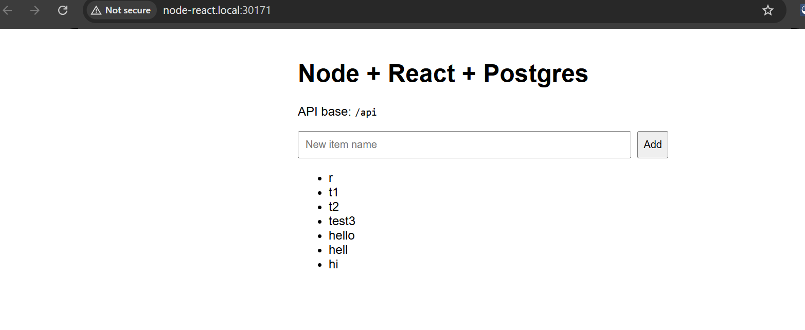
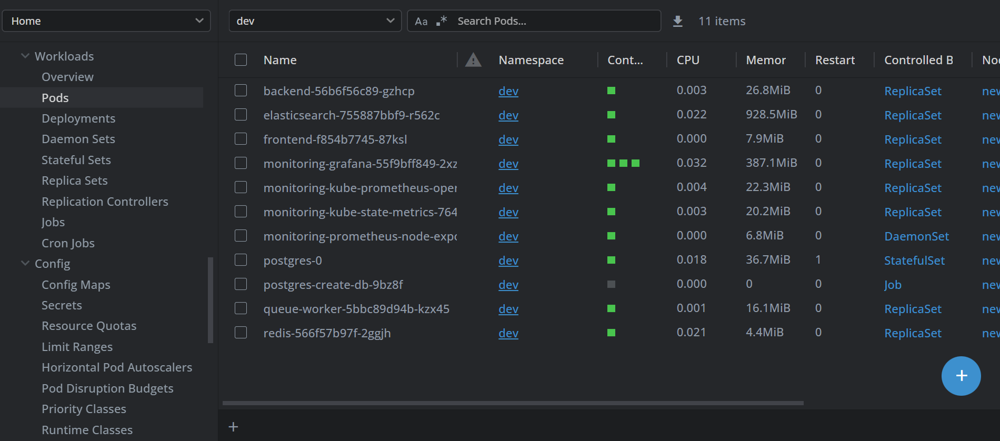

# Node.js / React / PostgreSQL Platform

A containerized Node.js + React + PostgreSQL application with Docker Compose for local development and Kubernetes manifests for cluster deployment. The platform includes Redis-backed background processing, search infrastructure, ingress routing, autoscaling, and monitoring components.

## 1. Technology Stack

| Service | Technology | Port | Purpose |
|---|---|---:|---|
| Frontend | React + Vite + Nginx | 80 | Web UI |
| Backend | Node.js + Express | 3000 externally / 4000 in Kubernetes | REST API |
| Database | PostgreSQL 16 | 5432 | Persistent application data |
| Cache / Queue | Redis 7 + BullMQ | 6379 | Queue and background jobs |
| Queue Worker | Node.js + BullMQ | — | Asynchronous job processing |
| Search | Elasticsearch 8.15.3 | 9200 | Search and indexing infrastructure |
| Ingress | NGINX Ingress Controller | 30171 (HTTP NodePort) | External HTTP routing |
| Metrics | Prometheus | 9090 internally | Metrics collection |
| Dashboards | Grafana | 3000 internally | Metrics visualization |
| Storage | NFS-backed Kubernetes PV/PVC | — | Persistent PostgreSQL storage |

## 2. Docker Compose — Local Development

### Quick Start

```bash
cp .env.example .env
docker compose up --build
```

Access the application:

- Frontend: http://127.0.0.1
- Backend API: http://127.0.0.1/api/items
- PostgreSQL: `localhost:5432`
- Redis: `localhost:6379`

Use the environment variables in `.env.example` to configure local services. Keep `.env` out of source control.

### Architecture

The Nginx frontend serves the compiled React application and proxies `/api/*` requests to the Node.js backend. The backend connects to PostgreSQL for persistent data and Redis for asynchronous jobs.

Docker Compose services share a custom bridge network and resolve each other through Docker DNS names such as `backend`, `postgres`, and `redis`.

### Multi-Stage Docker Builds

- **Backend:** Three stages — dependencies, build, and runtime. The final image uses a non-root `nodejs` user and installs production dependencies with `npm ci --omit=dev`.
- **Frontend:** Two stages — React/Vite build and Nginx runtime. Node.js is not required in the final frontend image.
- **Layer caching:** Dependency installation is separated from application source copying to improve rebuild efficiency.

Image-size and build-time improvements should be reported using measurements from the actual build environment rather than assumed figures.

### Security

- Run application containers as non-root users where supported.
- Keep credentials in environment variables or a secret-management system instead of hardcoding them.
- Exclude `.env` and sensitive files from Git using `.gitignore`.
- Bind development-only published ports to `127.0.0.1` where appropriate.
- Handle `SIGTERM` and graceful shutdown correctly.
- Use trusted, versioned images and regularly update dependencies.

### Data and Reliability

- Named volumes such as `postgres_data` and `redis_data` can preserve data across container restarts.
- `docker compose down -v` removes named volumes and can delete persistent local data.
- Health checks such as `pg_isready` help determine when PostgreSQL is ready.
- Use `depends_on` with health conditions where supported to reduce startup races.
- Apply resource limits where supported by the Compose runtime.

### Local Testing

```bash
docker compose ps

curl -i http://127.0.0.1/
curl -i http://127.0.0.1/api/health
curl -i http://127.0.0.1/api/items

curl -X POST http://127.0.0.1/api/items \
  -H "Content-Type: application/json" \
  -d '{"name":"Test Item"}'
```

Expected results depend on the application's implementation. Verify the health endpoint and API response before considering the test successful.

## 3. Kubernetes Deployment

### Overview

The application runs in the `dev` namespace and includes:

- Frontend and backend Deployments
- PostgreSQL with an NFS-backed PVC
- Redis and a separate BullMQ queue worker
- Elasticsearch using ephemeral `emptyDir` storage
- NGINX Ingress routing and rate limiting
- Backend CPU-based Horizontal Pod Autoscaler
- Prometheus/Grafana monitoring components

### Request Flow

```text
Browser
   |
   v
NGINX Ingress
   |----------------------|
   v                      v
Frontend Service      Backend Service
                          |
                    |-----|------|
                    v            v
                PostgreSQL     Redis/BullMQ
                                   |
                                   v
                              Queue Worker
```

Elasticsearch is a separate search service. Actual search functionality requires the application to index data and query Elasticsearch; deploying the service alone does not implement search.

### Kubernetes Access

Add the following entry to the Windows hosts file:

`C:\Windows\System32\drivers\etc\hosts`

```text
<master-ip> node-react.local
```

Open:

http://node-react.local:30171/

The assessment URL `http://node-react.local/` without a port requires port 80 on the client-facing host to reach the Ingress controller. A hosts-file entry only maps the hostname to an IP; it does not forward ports.

### Kubernetes DNS

Services in the same namespace can communicate using their service names, for example:

- `postgres-service`
- `redis-service`
- `backend-service`
- `elasticsearch`

A fully qualified service name can use the form:

`<service>.<namespace>.svc.cluster.local`

ClusterIP services provide internal connectivity without directly exposing databases or queues to external clients.

## 4. Redis, BullMQ, and Background Processing

### How It Works

1. **Frontend:** A user creates an item.
2. **Backend API:** Saves the item in PostgreSQL and adds a job to BullMQ.
3. **Redis queue:** Stores the pending job until a worker processes it.
4. **Queue worker:** Picks up the job and performs background work.

### Why Use a Separate Worker Deployment?

- **Responsive API:** Users do not have to wait for slow background tasks.
- **Independent scaling:** Workers can scale without scaling the API.
- **Retries and job tracking:** BullMQ supports job states and retries when configured.
- **Fault isolation:** A worker can restart without necessarily restarting the API.

### Current Worker Implementation

The current `worker.js` logs the job name and data. It is a placeholder for actual background processing, such as search indexing, notifications, or cache invalidation.

The separate Deployment demonstrates a Redis-backed queue with a dedicated consumer. It does not yet implement real search indexing.

### Verify Queue Processing

```bash
kubectl get pods -n dev | grep -E 'backend|queue-worker|redis'
kubectl logs -n dev deployment/backend
kubectl logs -n dev deployment/queue-worker
```

Create an item and confirm that a job is enqueued and the worker logs its processing. Configure retry policies and failure handling according to the application's requirements.

## 5. PostgreSQL and Database Routing

### Persistence

PostgreSQL uses a Kubernetes PVC backed by NFS. This allows database files to persist when the database Pod is recreated, provided the storage and database remain healthy.

### Read and Write URLs

The backend supports separate `DB_WRITE_URL` and `DB_READ_URL` configuration variables.

- **Writes:** Use `DB_WRITE_URL` for inserts, updates, deletes, and other operations that require the primary database.
- **Reads:** Use `DB_READ_URL` for queries that can be served by a read replica.
- **Current limitation:** Both URLs point to the same PostgreSQL instance. Separate URLs alone do not provide read scaling.
- **Replication lag:** If an asynchronous read replica is introduced, its data can lag behind the primary. Read-after-write operations may need to use the primary.

### Known Issue: PostgreSQL `pg_hba.conf` Error `28000`

**Symptom:** Backend database initialization failed because PostgreSQL had no matching `pg_hba.conf` rule for a connection from the Kubernetes Pod network.

**Root cause:** The existing PostgreSQL data directory contained a `pg_hba.conf` without a matching rule for application Pod connections. PostgreSQL also skipped initial database creation because an existing cluster directory was detected, leaving `appdb` initially missing.

**Resolution:**

1. Created `appdb` idempotently using a Kubernetes Job and verified the database.
2. Added a restricted SCRAM password-authentication rule for `appdb`, `appuser`, and the verified Pod CIDR.
3. Reloaded PostgreSQL configuration and restarted the backend rollout.
4. Verified database connectivity and backend readiness.

**Preventive measures:**

- Manage authentication rules as version-controlled configuration.
- Store database credentials in Kubernetes Secrets.
- Keep database initialization idempotent.
- Gate backend deployment on database readiness.
- Verify authentication rules after restoring or recreating the database.

The backend started successfully after the authentication rule was applied.

## 6. Elasticsearch

Elasticsearch provides indexing and search capabilities for application data.

### Kubernetes Configuration

- Runs as a single-node Elasticsearch Deployment in namespace `dev`.
- Exposes HTTP on port `9200` through an internal ClusterIP Service.
- Uses `discovery.type=single-node`.
- Uses ephemeral `emptyDir` storage rather than a PVC.

### Storage Limitation

Elasticsearch data is temporary. Data stored in `emptyDir` can be lost when the Pod is removed and recreated. This configuration is suitable for a disposable assessment environment, not production search data.

### Verify Elasticsearch

```bash
kubectl get pods,svc -n dev | grep elastic
kubectl rollout status deployment/elasticsearch -n dev
kubectl logs -n dev deployment/elasticsearch --tail=50

kubectl exec -n dev deployment/elasticsearch -- \
  curl -s http://localhost:9200/
```

The endpoint should return JSON containing Elasticsearch cluster and version information.

**Security note:** The current assessment configuration disables Elasticsearch security. Keep it isolated to the trusted development cluster and do not expose it publicly.

## 7. Ingress and Rate Limiting

NGINX Ingress routes incoming HTTP requests to internal services:

- `/` → `frontend-service`
- `/api` → `backend-service`

The configured annotations are:

```yaml
nginx.ingress.kubernetes.io/limit-rps: "10"
nginx.ingress.kubernetes.io/limit-burst-multiplier: "2"
```

These configure a request rate of 10 requests per second per client, with a burst allowance based on the multiplier.

Rate limiting helps protect backend services from excessive request traffic. It is not a substitute for authentication, authorization, or comprehensive DDoS protection.

### Verify Ingress

```bash
kubectl get ingress -n dev
kubectl get svc -n ingress-nginx
curl -I -H "Host: node-react.local" \
  http://10.10.200.170:30171/
```

## 8. Observability

### Prometheus

Prometheus collects metrics from configured targets. Depending on the installed configuration, these can include Kubernetes node, workload, and application metrics.

### Grafana

Grafana visualizes metrics using dashboards and Prometheus as a data source.

### Health Probes

- **Readiness probes:** Determine when a container is ready to receive traffic.
- **Liveness probes:** Help Kubernetes detect containers that are no longer functioning correctly.

### Centralized Logging

Fluent Bit can collect container logs and forward them to Loki or Elasticsearch for centralized search and troubleshooting.

**Verification status:** Confirm that the Prometheus server Pod is healthy, its targets are up, and Grafana can query metrics. The Fluent Bit → Loki/Elasticsearch logging pipeline must also be deployed and tested before it is considered operational.

## 9. Scaling

### Backend HPA

The backend HPA is configured with:

- Minimum replicas: `1`
- Maximum replicas: `5`
- Target CPU utilization: `70%`

The HPA depends on available resource metrics and appropriate CPU requests.

### Worker Scaling

The queue worker is a separate Deployment and can be scaled independently:

```bash
kubectl scale deployment queue-worker -n dev --replicas=2
kubectl get deployment queue-worker -n dev
kubectl get hpa -n dev
kubectl top pods -n dev
```

Manual scaling is useful for testing. For production, worker scaling may be better driven by queue depth and processing latency.

### Resource Requests and Limits

CPU and memory requests help Kubernetes schedule workloads. Limits constrain resource consumption where supported. Appropriate values should be adjusted using observed workload behavior.

## 10. High Availability

The current architecture provides some Kubernetes self-healing capabilities:

- Deployments recreate failed Pods to maintain the desired replica count.
- Multiple backend replicas can serve traffic through a ClusterIP Service.
- A separate worker Deployment isolates some background-processing failures from the API.
- PostgreSQL data persists on NFS across Pod recreation when the storage remains healthy.
- Readiness probes prevent traffic from being directed to unready Pods.

### Current Limitations

This is not a fully highly available architecture:

- PostgreSQL uses a single database instance.
- Redis uses a single instance.
- Elasticsearch uses a single replica and ephemeral storage.
- The application and monitoring stack do not yet have verified end-to-end redundancy.
- NFS availability remains a dependency for PostgreSQL persistence.

Production HA would require database replication and failover, resilient Redis configuration, appropriate Elasticsearch node redundancy and persistent storage, and sufficient cluster and storage redundancy.

## 11. Secrets Management with Sealed Secrets

Sealed Secrets encrypts Kubernetes Secret manifests so they can be stored in source control more safely than plaintext Secret manifests. A matching Sealed Secrets controller decrypts them into regular Kubernetes Secrets.

### Seal and Apply a PostgreSQL Secret

```bash
kubeseal --format yaml \
  --controller-namespace kube-system \
  --controller-name sealed-secrets \
  < postgres-secret.yaml \
  > postgres-sealed-secret.yaml

kubectl apply -f postgres-sealed-secret.yaml
kubectl get secret postgres-secret -n dev
```

The generated `postgres-sealed-secret.yaml` can be version-controlled, provided it was sealed for the correct cluster/controller and the private controller key is protected.

**Security considerations:**

- Base64 is encoding, not encryption.
- Never commit plaintext Secret files or decoded credentials.
- Avoid printing live passwords into terminals, CI logs, or shared output.
- Restrict Secret access using Kubernetes RBAC.
- Rotate credentials if they are exposed.

## 12. CI/CD Pipeline — Future Implementation

**Status: Not implemented due to assessment time constraints.**

The CI/CD pipeline was planned but could not be configured within the available assessment time. The application was prepared for containerized deployment, and Kubernetes deployment was performed separately.

### Planned Workflow

| Branch / Tag | Target Environment |
|---|---|
| `master` | Development |
| `pre-release/v*` | Pre-production |
| `release/v*` | Release / Production |

### Planned Pipeline Stages

1. Run application tests and build validation.
2. Build frontend and backend Docker images.
3. Tag images using the branch name and short Git commit SHA.
4. Push images to the container registry.
5. Deploy the corresponding image to the target Kubernetes environment.
6. Verify deployment health and support rollback to a previous working version.

### Security Considerations

- Store registry credentials and deployment secrets in GitHub Actions Secrets or an equivalent secret-management system.
- Never commit plaintext credentials to the repository.
- Use immutable image tags for traceability and rollback.
- Verify rollout status after each deployment.

**Future improvement:** Implement and test the workflow using GitHub Actions or an equivalent CI/CD platform, including automated tests, registry publishing, environment-specific deployment, and rollback validation.

## 13. Troubleshooting and Useful Commands

### Inspect Workloads

```bash
kubectl get all -n dev
kubectl get pods,svc,deployments -n dev
kubectl describe pod -n dev <pod-name>
kubectl get events -n dev --sort-by=.lastTimestamp
```

### Check Storage and Autoscaling

```bash
kubectl get pvc -n dev
kubectl get hpa -n dev
kubectl top pods -n dev
```

### Inspect Application Logs

```bash
kubectl logs -n dev deployment/backend
kubectl logs -n dev deployment/queue-worker
kubectl logs -n dev deployment/elasticsearch
```

### Apply Manifests

```bash
kubectl apply -f <manifest>.yaml
kubectl rollout status deployment/<deployment-name> -n dev
```

## 14. Project Layout

```text
Dockerfile.backend
Dockerfile.frontend
docker-compose.yml
.env.example
backend/
  src/
frontend/
  src/
  nginx.conf
k8s/
  # Kubernetes manifests and environment overlays
```

The exact repository layout may differ. Keep manifests, application source, Dockerfiles, and CI/CD workflows version-controlled, excluding credentials and generated local secrets.


**Design summary:** The platform separates user-facing API traffic from asynchronous background processing, uses Kubernetes Services for internal communication, persists PostgreSQL data using NFS-backed storage, and provides an extensible foundation for search, observability, autoscaling, and secure CI/CD. Features such as read replicas, full HA, real search indexing, and end-to-end centralized logging require additional implementation and verification.